<div align="center">

# 桌面信息屏 DeskScreen

**给 ESP32-S3-BOX-3 的开源桌面小屏固件：时钟天气、GitHub 热力图、番茄钟、像素小猫、AI 语音聊天、相册影片音乐，一块板子全包。**

[](https://github.com/zjxlink/test-repo/actions/workflows/build.yml)
[](https://github.com/zjxlink/test-repo/releases/latest)
[](LICENSE)


**简体中文** · [English](README.en.md)

[一键刷机](https://zjxlink.github.io/test-repo/) · [功能详解](docs/features.md) · [更新记录](CHANGELOG.md) · [开发指南](docs/development.md)

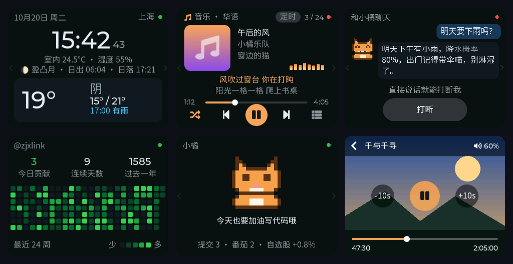

</div>

## ✨ 亮点

- **不用装软件就能刷机**：电脑上用 Chrome 打开[刷机页面](https://zjxlink.github.io/test-repo/)，插上 USB 点一下按钮
- **手机配网、网页设置**：第一次开机用手机连热点选 WiFi，之后在浏览器里打开 `http://deskscreen.local` 改所有设置，不用 App
- **给程序员的信息屏**：GitHub 贡献热力图、自选股、新闻热榜、天气预报，加上番茄钟和久坐提醒
- **会陪你的像素小猫「小橘」**：心情跟着你的提交、番茄和股票走，摇一摇会晕，还能玩跑酷小游戏
- **能聊天的 AI 小猫**：喊「喵喵同学」就能对话，实时语音、可以随时插话（阿里云百炼 Qwen-Omni）
- **小小的影音中心**：TF 卡相册（照片、GIF、视频）、带声音的影片、带歌词和封面的音乐播放器
- **省心**：自动在线升级、失败自动回滚，白屏花屏自动恢复，出问题网页上就能看诊断

## 📸 截图

> 截图来自在电脑上运行的同一套界面代码，和板子上显示的一致。

<table>
  <tr>
    <td align="center">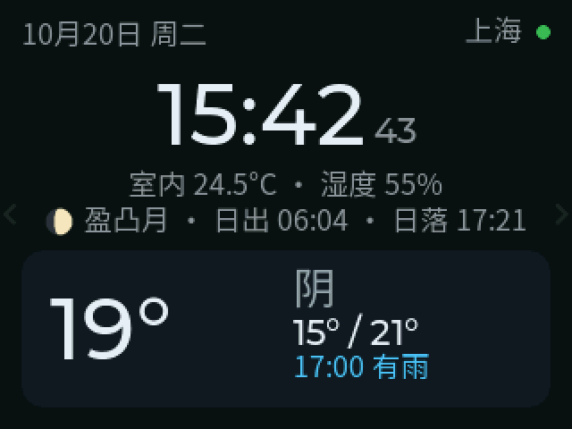<br>时钟、月相、日出日落</td>
    <td align="center">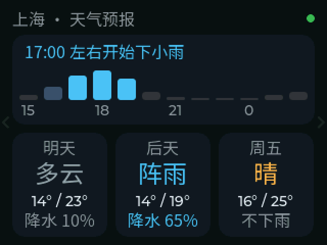<br>12 小时降水和 3 天预报</td>
    <td align="center">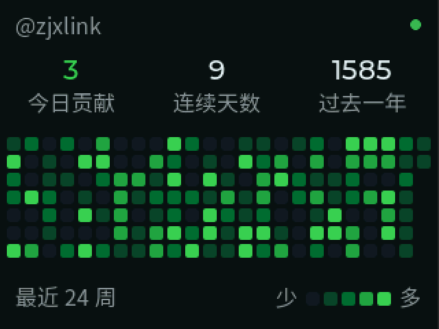<br>GitHub 贡献热力图</td>
  </tr>
  <tr>
    <td align="center">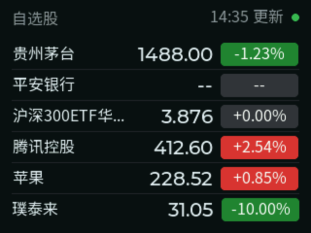<br>自选股（A 股、港股、美股）</td>
    <td align="center"><br>资讯热榜和 RSS</td>
    <td align="center">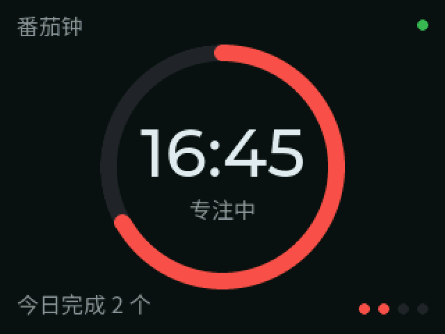<br>番茄钟</td>
  </tr>
  <tr>
    <td align="center">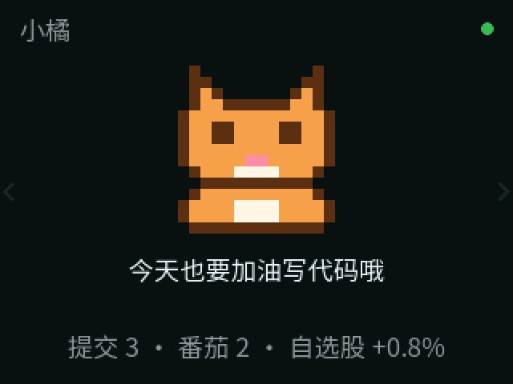<br>像素小猫「小橘」</td>
    <td align="center">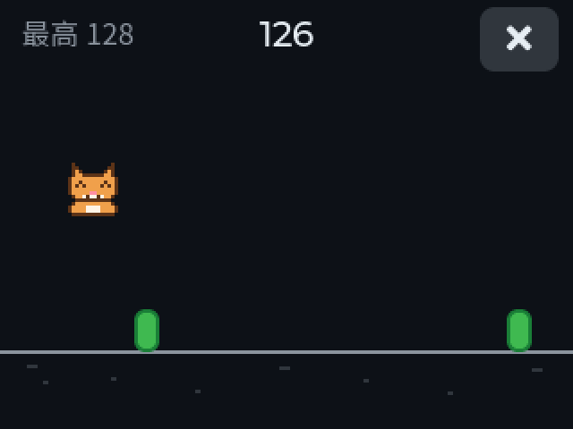<br>小游戏「小橘跑酷」</td>
    <td align="center">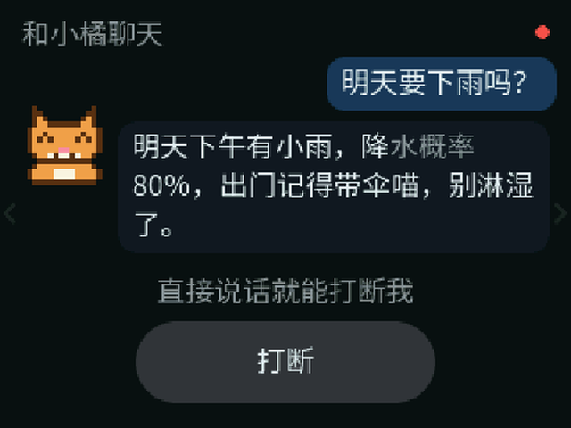<br>和小橘语音聊天</td>
  </tr>
  <tr>
    <td align="center">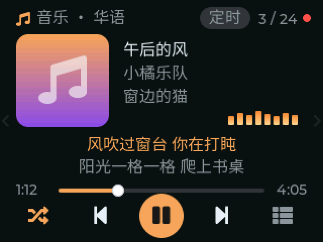<br>音乐播放器</td>
    <td align="center">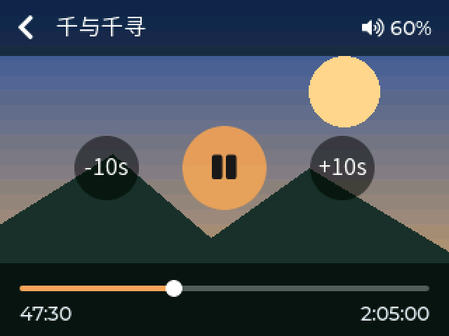<br>影片</td>
    <td align="center">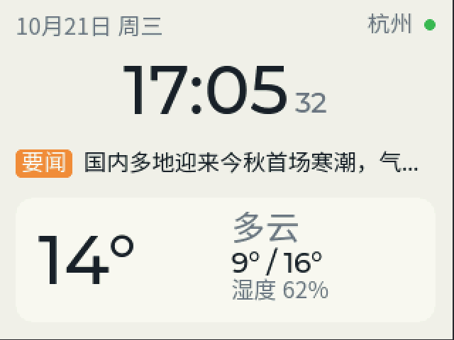<br>浅色主题</td>
  </tr>
</table>

<details>
<summary>手机上的设置网页（点开看）</summary>
<br>
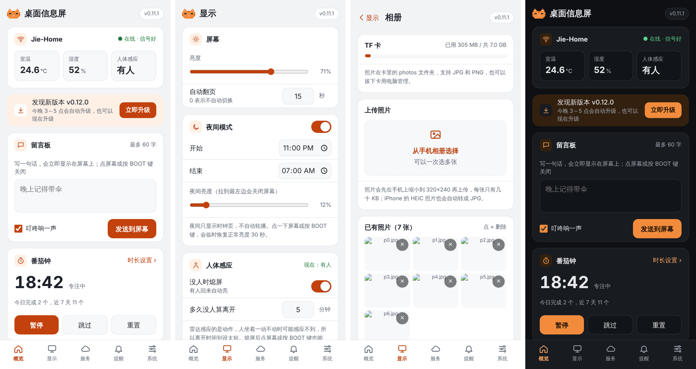
</details>

## 🧩 功能

| 分类 | 功能 |
|---|---|
| 信息 | 时钟（NTP 对时）、月相和日出日落、天气和 3 天预报（[Open-Meteo](https://open-meteo.com)，免 Key）、下雨提醒、GitHub 贡献热力图、自选股、资讯（新浪分类、百度热搜、知乎热榜、IT之家、自定义 RSS）、室内温湿度 |
| 效率 | 番茄钟（带统计和提示音）、久坐和喝水提醒、整点报时、闹钟、留言板（手机发一句话到屏幕） |
| 小橘 | 像素小猫，心情随你的提交、番茄和股票变化；摇一摇、倒过来、急刹都会有反应；跑酷小游戏；跟着音乐节拍摇摆 |
| AI 语音 | 唤醒词「喵喵同学」（在板子上识别，不上传），实时语音对话，回声消除可插话，对话气泡和字幕，能念新闻 |
| 影音 | TF 卡相册（JPG、PNG、GIF、MJPEG 视频，手机直接上传）、必应每日一图、屏保；影片页（带声音、快进、记住看到哪）；音乐播放器（MP3、FLAC、WAV，歌单、封面、歌词、后台播放、睡眠定时） |
| 屏幕 | 点左右半边或滑动翻页、长按出快捷设置、选择显示哪些页面、深色 / 浅色 / 按日出日落自动切换、日落后自动调暗、没人自动熄屏（毫米波雷达） |
| 系统 | 网页设置（配对码登录）、在线升级（GitHub 或自建服务器，失败自动回滚）、白屏花屏自动恢复、网页诊断页 |

每个功能的完整说明和设置方法见 **[功能详解](docs/features.md)**。

## 🔧 硬件

| | 说明 |
|---|---|
| 主板 | [乐鑫 ESP32-S3-BOX-3](https://github.com/espressif/esp-box)（ESP32-S3，16 MB Flash，16 MB PSRAM，2.4 寸 320×240 触摸屏，双麦克风，喇叭，姿态传感器） |
| 选配 | BOX-3 SENSOR 底座：温湿度、毫米波雷达（没人熄屏）、TF 卡槽（相册、影片、音乐）。没插底座时这些功能自动不启用 |
| TF 卡 | FAT32 格式（32 GB 以内的卡出厂就是），放 `photos`、`movies`、`music` 文件夹 |

固件依赖 16 MB PSRAM（唤醒词、TLS、相册、影片和界面都放在 PSRAM 里）。仓库里还有一个给自制 PCB 准备的 `desk_v1` 编译环境，目前只停留在配置阶段，详见[开发指南](docs/development.md)。

## 🚀 快速上手

**1. 刷机**：用电脑上的 Chrome 或 Edge 打开 **<https://zjxlink.github.io/test-repo/>**，用 USB-C 连上 BOX-3，点「连接板子并刷机」，几分钟就好。页面上有每一步的说明。

**2. 配网**：板子开机后屏幕会显示一个 `DeskScreen-XXXX` 的 WiFi 热点。手机连上它，在弹出的页面里选你家的 WiFi（没弹出就用浏览器打开 `192.168.4.1`）。以后要换 WiFi，长按 BOOT 键 3 秒。

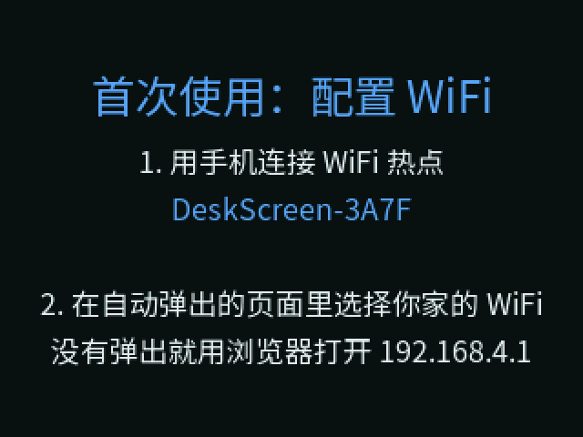

**3. 打开设置网页**：手机和板子在同一个 WiFi 下，用浏览器打开 `http://deskscreen.local`（或屏幕上显示的 IP），输入屏幕上显示的 6 位配对码。也可以长按屏幕 2 秒打开快捷设置，扫里面的二维码。

**4. 按需填写服务**：城市、[GitHub Token](docs/features.md#设置-github-热力图)、[自选股](docs/features.md#设置自选股)、[资讯来源](docs/features.md#设置资讯)、[AI 语音聊天的百炼 API Key](docs/features.md#设置-ai-语音聊天)，都在设置网页的「服务」里。

> 只想用时钟、天气、番茄钟和小猫的话，第 4 步可以跳过。

## 🔄 在线升级

- 板子每天检查一次 [GitHub Release](https://github.com/zjxlink/test-repo/releases)，有新版本时在凌晨 3～5 点自动安装（可以关掉），也可以在设置网页「系统 › 固件升级」里手动升级或上传固件
- 新固件启动后要连续正常运行 30 秒才算升级成功，在那之前崩溃会自动退回旧固件
- 访问 GitHub 慢的话，可以在自己的 NAS 或服务器上跑 [OTA 镜像服务](server/ota-mirror/README.md)（[飞牛 fnOS 部署教程](docs/ota-server-fnos.md)），再在设置网页「自建升级服务器」里填上它的地址，板子会先试它

## 🛠️ 从源码编译

需要 [PlatformIO](https://platformio.org)（VS Code 插件或命令行都行）：

```bash
git clone https://github.com/zjxlink/test-repo.git
cd test-repo/firmware
pio run -e box3 -t upload    # 编译并烧录到 BOX-3
pio device monitor           # 看串口日志
pio test -e native           # 在电脑上跑单元测试
```

目录结构、发布流程、刷开发版和中文字体生成见 **[开发指南](docs/development.md)**。

## 🗺️ 路线图

- [x] 时钟天气、GitHub、自选股、资讯、番茄钟、提醒和闹钟
- [x] 像素小猫、跑酷小游戏、AI 语音聊天
- [x] 相册、影片、音乐播放器
- [x] 网页刷机、配对码登录、升级失败自动回滚
- [ ] 语音控制板子（调音量、开番茄钟、定闹钟）和聊天记忆
- [ ] 待办事项
- [ ] 自制 PCB 和外壳

各版本的改动见 [CHANGELOG](CHANGELOG.md)。

## 🤝 参与贡献

欢迎提 Issue 和 Pull Request！提问题前可以先看看设置网页「系统 › 诊断」，附上里面的信息能更快定位。贡献代码前请读 [CONTRIBUTING](CONTRIBUTING.md)。

## 📄 开源许可

本项目以 [GPL-3.0](LICENSE) 协议开源：可以自由使用、修改和分发，但分发修改后的版本（包括预装在硬件里出售）时必须同样以 GPL-3.0 公开源代码。

## 🙏 致谢

用到的第三方代码和资源各自遵循原来的协议：

- [LVGL](https://lvgl.io)（MIT）、[LovyanGFX](https://github.com/lovyan03/LovyanGFX)（FreeBSD）、[WiFiManager](https://github.com/tzapu/WiFiManager)（MIT）、[ArduinoJson](https://arduinojson.org)（MIT）
- [minimp3](https://github.com/lieff/minimp3)（CC0）、[dr_flac](https://github.com/mackron/dr_libs)（公有领域 / MIT-0）
- [Noto Sans SC](https://fonts.google.com/noto/specimen/Noto+Sans+SC) 字体（SIL OFL 1.1）
- [乐鑫 esp-sr](https://github.com/espressif/esp-sr) 唤醒词库和模型（乐鑫协议，只能用在乐鑫芯片上）

天气、行情、资讯、必应图片等数据来自各家的公开接口，仅供个人使用，版权和使用条款归原网站所有。
