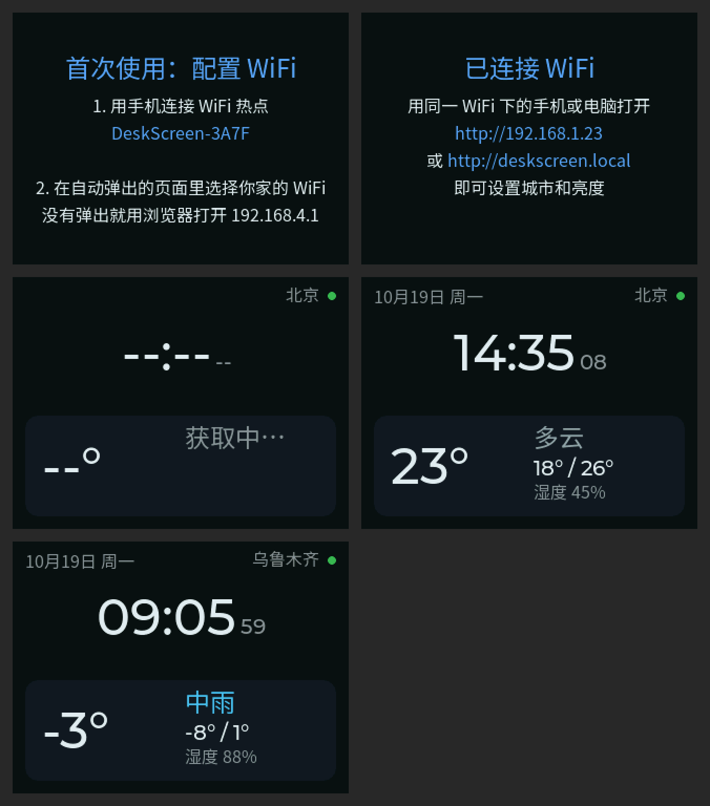
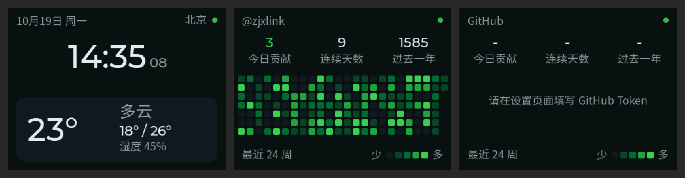
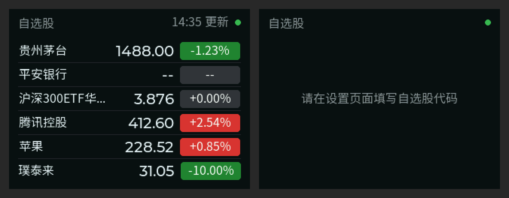
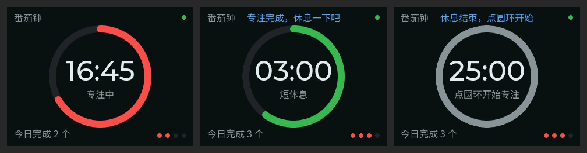

# 桌面信息屏

基于 ESP32-S3 的桌面小屏幕，显示时间、天气、GitHub 贡献热力图、自选股行情、番茄钟、像素小猫和电子相册，能和小猫语音聊天，还有提醒、闹钟和室内温湿度。目标用户是程序员和科技爱好者。各版本的改动见 [CHANGELOG](CHANGELOG.md)。









## 当前功能（v0.13）

- 手机配网：首次开机设备会开一个 WiFi 热点，手机连上后选择家里的 WiFi 即可，不用装 App
- 时间日期：NTP 自动对时（北京时间）
- 天气：当前气温、天气、今日最高和最低气温、湿度。数据来自 [Open-Meteo](https://open-meteo.com)，免费，不需要 API Key，每 15 分钟刷新一次
- 网页设置：同一 WiFi 下用浏览器打开 `http://deskscreen.local`（或屏幕上显示的 IP），手机上用底部导航在「概览、显示、服务、提醒、系统」之间切换，改完点底部浮出的「保存」。网页源码在 `firmware/web/index.html`，编译时自动压缩进固件。「系统」里的「诊断」显示天气、GitHub、自选股、在线升级最近一次请求的结果和失败原因，以及内存（含 PSRAM 总量、剩余和最低剩余）、已运行时间和屏幕自动恢复的次数，出问题时不用接串口也能排查
- 重新配网：长按 BOOT 键 3 秒，或者在设置页面里点「重新配置 WiFi」
- GitHub 贡献热力图：最近 24 周的贡献格子（配色和 GitHub 一致），以及今日贡献、连续天数、过去一年总数，每 30 分钟刷新
- 自选股行情：最多 6 只，支持 A 股、港股、美股和 ETF，红涨绿跌。交易时段每分钟刷新，其余时间 10 分钟一次。数据来自东方财富的公开接口（非官方接口，适合个人使用）；东方财富会按 IP 限流，失败后改用腾讯行情，并暂停请求东方财富 5～30 分钟
- 夜间自动调暗：默认 23:00～7:00 把屏幕调到很暗（亮度可调，可以直接关掉背光），亮度渐变不突兀；夜间固定显示时钟页，点一下屏幕或按 BOOT 键临时恢复正常亮度 30 秒。时间段可在设置页面修改或关闭
- 番茄钟：专注 25 分钟、短休息 5 分钟，每 4 个番茄长休息 15 分钟（都可以改）。点屏幕中间的圆环开始/暂停，按住 1.5 秒重置；设置页面也有控制按钮（没有触摸屏的板子用这个）。阶段结束时屏幕自动点亮并跳到番茄钟页提示；专注结束自动开始休息，休息结束等你点开始。进行中时自动轮播停在番茄钟页
- 番茄钟完成数：番茄钟页显示今日完成几个，设置页面还能看到近 7 天的总数。数据存在设备上，重启和升级都不会丢
- 留言板：在设置网页「概览」里写一句话（最多 60 个字），点「发送到屏幕」，设备立即全屏显示这条留言，可以选择「叮咚」响一声。点屏幕或按 BOOT 键关闭
- 久坐提醒和喝水提醒：在设置网页「提醒 › 健康提醒」里打开，间隔分别默认 45 分钟和 60 分钟，只在提醒时段（默认 9:00～21:00）内提醒。到点时屏幕全屏提示并响一声，5 分钟没人理会自动关掉。番茄钟专注时先不打扰，等休息时再提醒；开始休息时久坐提醒重新计时
- 像素小猫「小橘」：一只 16x16 像素画的橘猫，会眨眼、呼吸。心情跟着你走：今天有 GitHub 提交或完成了番茄就开心得蹦起来；自选股平均跌超过 2% 会掉眼泪；下午了还没提交会无聊；夜间时段睡觉打呼。参与自动轮播
- 小橘对动作有反应（BOX-3）：用板载的姿态传感器，摇一摇它会晕（会跳到小猫页给你看），倒过来会喊「快把我放正」，急刹、急转或者被拿起来时会吓一跳（只在显示小猫页时，开车时不会乱翻页）。不管板子怎么摆、车里斜着装都能用
- 小游戏「小橘跑酷」：在小猫页点一下小橘开始，点屏幕起跳躲开黄瓜，越跑越快。最高分会保存，点右上角叉、按 BOOT 键或 30 秒不玩自动退出
- AI 语音聊天（BOX-3）：在「和小橘聊天」页按住按钮说话，松手后小橘用语音回答，文字也显示在屏幕上。用的是阿里云百炼的 Qwen-Omni 模型（按用量计费），在设置网页填上百炼 API Key 就能用；模型和音色也可以在设置网页改。这一页不参与自动轮播，点屏幕切换页面时能切到
- 电子相册（BOX-3 插 SENSOR 底座和 TF 卡）：点屏幕切到「相册」页，轮播 TF 卡 photos 文件夹里的 JPG、PNG 照片（默认每张 10 秒、随机顺序），大照片会自动缩小居中，手机原图也能放，只是每张要读一两秒。在设置网页「显示 › 相册与屏保」里点「上传 / 管理」，可以一次选多张照片上传（手机上先缩小到 320x240 再传，iPhone 的 HEIC 也会转成 JPG），也能看缩略图、删除。卡要是 FAT32 格式（32GB 以内的卡出厂就是），照片放在卡的 photos 文件夹，也可以用读卡器直接拷进去。在设置网页打开「屏保」后，多少分钟没碰屏幕（默认 5 分钟）自动进入相册，碰一下回到原来的页面；番茄钟进行中、夜间时段和没人熄屏时不启动
- 必应每日一图：相册的第二个图片来源，每天自动从 cn.bing.com 下载一张 320×240 的风景壁纸，存在 TF 卡的 bing 文件夹（最多 60 张，满了先删最早的），没插卡时只在内存里放当天这一张。「放自己的照片」和「放必应每日一图」是两个独立开关（在「显示 › 相册与屏保」里），都开时交替播放；图片底部的标题和地点可以关掉；管理页里能删掉不喜欢的，删掉的不会再下载回来
- 整点报时和闹钟：在设置网页「提醒 › 闹钟」里打开（默认关闭）。整点报时每到整点叮一声，夜间时段不响；闹钟可以选时间和星期几（默认周一到周五 7:30），响时屏幕全屏提示、每隔几秒响一次，夜里也会响，点屏幕或按 BOOT 键关掉，5 分钟后自动停止。量产板没有喇叭，只在屏幕上提示
- 室内温湿度（BOX-3 插 SENSOR 底座）：时钟页时间下面显示底座测到的温度和湿度，每 5 秒更新。温度超过 30°C 或湿度超过 80% 持续 3 分钟，全屏提醒「有点热了」「有点闷了」，同一种提醒 1 小时最多一次，降下来以后才会再提醒，夜间时段不提醒。阈值和温度校准在设置网页「提醒 › 太热 / 太闷提醒」里改，人体感应在「显示 › 人体感应」里
- 没人熄屏、有人亮屏（BOX-3 插 SENSOR 底座）：用底座的毫米波雷达感应有没有人，5 分钟没感应到动作就关掉背光，有人回来自动亮起（夜间只恢复到夜间亮度）。熄屏时点屏幕或按 BOOT 键也能亮，有提醒时自动亮屏。离开时间可改，也可以关掉。没插底座时这两项自动不启用
- 番茄钟提示音（BOX-3）：专注结束播放下行三个音，休息结束播放上行三个音；音量可调，默认夜间时段不响。设置页面可以试听
- 在线升级（OTA）：设备每天检查一次 GitHub Release，有新版本时在凌晨 3～5 点自动安装（可关闭）；也可以在设置页面手动检查、立即升级，或者直接上传固件文件。升级时屏幕显示进度，写入后校验 MD5，失败不会影响旧固件
- 白屏、花屏自动恢复：屏幕控制芯片被供电抖动或静电干扰后会白屏或花屏，设备每 2 秒读一次屏幕状态，连续两次不对就重新初始化屏幕，几秒内恢复；另外每分钟整屏重画一次。读不出状态的屏幕改为每 10 分钟重新初始化一次。恢复次数显示在设置网页「系统」的「诊断」里
- 快捷设置（BOX-3）：在任意页面按住屏幕 2 秒（番茄钟圆环上按住是重置番茄钟），打开快捷设置页，可以调亮度、开关提示音和「没人熄屏」，改完立即保存。页面上还有一个二维码，手机扫码直接打开网页设置，不用记 IP。点右上角的叉、按 BOOT 键或 30 秒不操作自动关闭
- 多页面：点屏幕右半边到下一页、左半边回到上一页，也可以在屏幕上任意位置左右滑动翻页（手指往左滑到下一页，往右滑回上一页）。页面左右边缘有淡淡的 < > 提示。番茄钟圆环、小橘、聊天按钮这些点中间的东西是操作它们，点两边空白才翻页（BOX-3，松手时才切换，这样按住不会先翻页），短按 BOOT 键到下一页，页面滑动时连续快点也不会重启；也可以在设置页面设定自动轮播间隔（默认 15 秒，只轮播已经设置好的页面）

### 设置 GitHub 热力图

1. 打开 https://github.com/settings/tokens/new?description=DeskScreen 创建一个 classic Token，**不用勾选任何权限**（这样的 Token 只能读公开信息，泄露了也改不了你的任何东西），有效期按需选择
2. 在设置网页「服务 › GitHub 贡献热力图」里粘贴 Token 并保存

设备用内置的根证书校验 api.github.com 的 HTTPS 证书，Token 不会被中间人截获。Token 只保存在设备上，设置页面不会显示它。如果想统计私有仓库的贡献，需要在 GitHub 个人主页的贡献图设置里打开「Private contributions」。

### 设置 AI 语音聊天

1. 打开 [阿里云百炼控制台](https://bailian.console.aliyun.com/)（北京地域），在「API Key」里创建一个 Key。按用量计费，新用户有免费额度
2. 在设置网页「服务 › AI 语音聊天」里粘贴 Key 并保存。模型默认 `qwen3-omni-flash`，音色默认 `Cherry`（女声），也可以填 `Ethan`（男声）等

Key 只保存在设备上，设置网页不会显示它。

### 设置自选股

在设置网页「服务 › 自选股」里点「+ 添加」，一次输入一个代码，点代码旁的叉删除：

| 写法 | 含义 |
|---|---|
| `600519`、`000001`、`510300` | A 股和 ETF，6 位代码，自动判断沪市/深市/北交所 |
| `sh000001` | 加前缀指定市场，例如上证指数（和深市的 000001 平安银行区分） |
| `00700` 或 `hk700` | 港股 |
| `AAPL`、`BRK.B` | 美股，会自动在纳斯达克、纽交所、美交所里查找 |

### 发布新版本（OTA）

两种方式任选一种：

- **网页（手机也行）**：打开仓库的 Actions → Release → Run workflow，填写版本号（如 `v0.5.0`），点运行。会在 `main` 的最新提交上创建标签
- **命令行**：`git tag v0.5.0 && git push origin v0.5.0`

之后 GitHub Actions 会检查版本号、跑单元测试、编译两个板子的固件、生成 `manifest.json` 并创建 Release。设备从 `releases/latest/download/manifest.json` 检查更新，只有正式版本号（vX.Y.Z）之间才会自动升级；本地编译的开发版不会被自动覆盖，但可以在设置页面手动装上最新正式版。

Release 里每个板子有两个文件：

| 文件 | 用途 |
|---|---|
| `firmware-box3-merged.bin` | 第一次烧录，用网页工具写到 `0x0` |
| `firmware-box3.bin` | 已经装过的设备，在设置页面上传升级（OTA 也下载这个） |

国内访问 GitHub 慢的话，可以把 Release 文件同步到自己的服务器，然后修改 `src/ota.cpp` 里的 `OTA_MANIFEST_URL`。

## 硬件

| 板子 | 屏幕 | 编译环境 |
|---|---|---|
| 乐鑫 ESP32-S3-BOX-3（开发用） | 2.4 寸 ILI9342C，320×240 | `box3` |
| 自己画的 PCB（量产用） | 2.0 寸 IPS ST7789，240×320 横屏使用 | `desk_v1` |

两种板子的界面都按 320×240 横屏设计，UI 代码通用。量产板的引脚在 `firmware/include/board.h` 中，目前和 BOX-3 保持一致，画 PCB 时如有改动，改这里就行。

## 编译和烧录

需要安装 [PlatformIO](https://platformio.org)（VS Code 插件或命令行都可以）。

```bash
cd firmware
pio run -e box3 -t upload    # 编译并烧录到 BOX-3
pio device monitor           # 查看串口日志
```

BOX-3 用 USB-C 连电脑就能烧录。如果烧录失败，按住 BOOT 键再按一下 RESET 键进入下载模式后重试。

### 不装软件，用网页烧录

每次推送代码，GitHub Actions 都会自动编译，并生成一个合并好的 `firmware-merged.bin`（在 Actions 页面对应运行记录底部的 Artifacts 里下载，`firmware-box3` 是 BOX-3 用的）。

1. 用 Chrome 或 Edge 打开 https://espressif.github.io/esptool-js/
2. 用 USB-C 连上设备，点 **Connect**，选择设备的串口
3. Flash Address 填 `0x0`，选择 `firmware-merged.bin`，点 **Program**
4. 烧完按一下 RESET 键

本地编译时，这个文件也会生成在 `firmware/.pio/build/<环境名>/firmware-merged.bin`。

## 目录结构

```
firmware/
  platformio.ini       编译配置（box3 / desk_v1 固件，native 单元测试）
  include/board.h      各板子的引脚定义
  include/lv_conf.h    LVGL 配置
  src/main.cpp         启动流程、主循环
  src/display.cpp      屏幕驱动（LovyanGFX）和 LVGL 对接
  src/ui.cpp           界面
  src/weather.cpp      后台拉取天气
  src/web_config.cpp   局域网设置页面
  src/github.cpp       后台拉取 GitHub 贡献日历（GraphQL API）
  src/github_parse.cpp 解析贡献日历、计算连续天数（不依赖硬件，有单元测试）
  src/root_ca.h        访问 GitHub 用的根证书
  src/ota.cpp          在线升级和网页上传升级
  src/ota_util.cpp     版本号比较、manifest 解析、固件格式检查（有单元测试）
  src/stock.cpp        后台拉取自选股行情
  src/stock_parse.cpp  解析股票代码和行情（不依赖硬件，有单元测试）
  src/night.cpp        夜间模式的时间计算（有单元测试）
  src/screen_ctrl.cpp  亮度渐变、夜间点亮、页面轮播的状态机（不依赖硬件，有按时间线模拟的场景测试）
  src/pomodoro.cpp     番茄钟状态机（有单元测试）
  src/sound_synth.cpp  提示音合成（有单元测试）
  src/audio.cpp        BOX-3 的 ES8311 解码芯片和 I2S 播放
  src/settings.cpp     设置保存（NVS）
  src/screen_load.cpp  切换页面（先收尾没播完的滑动动画，避开 LVGL 8.3 快速连点会重启的问题）
  src/panel_watch.cpp  屏幕控制芯片看门狗，白屏、花屏时重新初始化（有单元测试）
  src/pomo_stats.cpp   番茄钟近 7 天完成数（有单元测试）
  src/reminder.cpp     久坐、喝水提醒的计时（有单元测试）
  src/clock_events.cpp 整点报时和闹钟（有单元测试）
  src/pet.cpp          像素小猫的心情和图案（有单元测试）
  src/sensors.cpp      SENSOR 底座的温湿度传感器和人体感应雷达
  src/climate.cpp      温湿度解析和「有点热」「有点闷」提醒（有单元测试）
  src/net.cpp          网络和内存诊断
  src/imu.cpp          板载加速度计
  src/motion.cpp       认出摇一摇、急刹急转、倒过来（有单元测试）
  src/runner.cpp       小游戏「小橘跑酷」（有单元测试）
  src/voice.cpp        AI 语音聊天：录音、联网、播放
  src/omni.cpp         百炼 Qwen-Omni 请求和流式回复解析（有单元测试）
  src/dashscope_ca.h   访问百炼用的根证书
  src/photos.cpp       电子相册：读 TF 卡、解码、轮播、屏保
  src/album.cpp        相册里不依赖硬件的部分：文件名、轮播顺序（有单元测试）
  src/bing.cpp         必应每日一图的下载和存储
  src/bing_parse.cpp   解析必应接口返回（有单元测试）
  src/bing_ca.h        访问 cn.bing.com 用的根证书
  src/fonts/           中文字体（自动生成，不要手改）
  web/index.html       设置网页（编译时压缩进固件）
  tools/gen_fonts.py   中文字体生成脚本
  tools/merge_bin.py   编译后生成单文件固件
  tools/version.py     编译前从 git 标签生成版本号
  tools/check_image.py 检查编译出的固件格式（CI 用）
  tools/make_manifest.py 发布时生成 OTA 的 manifest.json
  tools/web_gz.py      编译前把 web/index.html 压缩成固件里的数据
  test/                单元测试（pio test -e native，在电脑上运行）
```

## 中文字体

LVGL 自带的中文字体以繁体和日文为主，缺很多简体字，所以用 [Noto Sans SC](https://fonts.google.com/noto/specimen/Noto+Sans+SC)（SIL OFL 协议，可以商用）自己生成：

- `font_cn_16`：GB2312 全部汉字（6763 个）加上界面用到的字，用于普通文字、城市名和股票名
- `font_cn_24`：只含界面用到的字，用于标题和天气描述

**改了界面上的中文后要重新生成字体**，否则新的字会显示成方框：

```bash
cd firmware
npm install lv_font_conv@1.5.2 @expo-google-fonts/noto-sans-sc@0.4.4
python3 tools/gen_fonts.py node_modules/@expo-google-fonts/noto-sans-sc/400Regular/NotoSansSC_400Regular.ttf
```

## 路线图

- [x] v0.1 时间、天气、配网、网页设置
- [x] GitHub 贡献热力图
- [ ] GitHub Star 数、仓库动态
- [x] 自选股行情
- [ ] 场外基金估值
- [x] 多页面切换（触摸或按键）
- [x] 番茄钟
- [x] 番茄钟提示音（BOX-3）
- [x] 留言板
- [x] 久坐和喝水提醒
- [x] 像素小猫「小橘」
- [x] 整点报时和闹钟
- [x] 室内温湿度、没人熄屏（BOX-3 SENSOR 底座）
- [x] 快捷设置页（长按屏幕）
- [x] 像素小游戏「小橘跑酷」
- [x] AI 语音聊天（阿里云百炼）
- [x] 电子相册（TF 卡、手机上传、屏保）
- [x] 必应每日一图
- [x] 小橘对动作有反应（姿态传感器）
- [x] 设置网页改版（分区和底部导航）
- [ ] 量产板加蜂鸣器
- [ ] 待办事项
- [x] OTA 在线升级
- [x] 夜间自动调暗（按时间；量产板可加光敏电阻按环境光调）
- [ ] 量产板 PCB 和外壳
